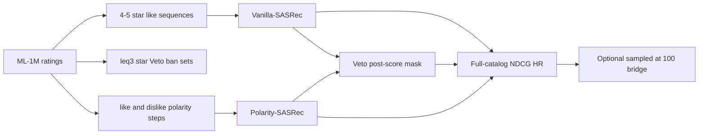

# Next-Movie Recommender: Rating-aware Self-Attention

**Self-Attentive Sequential Recommendation (SASRec)** on MovieLens-1M, with **Proposed Enhanced** rating-aware variants (**Veto-SASRec**, **Polarity-SASRec**), full-catalog evaluation, and a protocol bridge to the paper’s sampled@100 exam.

Live site: https://ag-68.github.io/Streaming_Session_Recommender/

```text
Keywords: sequential recommendation, SASRec, self-attention, MovieLens-1M,
          full-catalog ranking, NDCG@10, rating-aware recommendation, polarity embeddings
```

## Why this repo

Kang & McAuley (2018) **SASRec** is usually cited with **sampled** Hit/NDCG (~0.59 NDCG@10 on ML-1M). Production-style ranking is closer to **full catalog** (~0.15–0.17 for the same architecture family). This project:

1. Implements an id-order **Vanilla-SASRec** baseline with **full-catalog** cross-entropy and leave-one-out eval.
2. Adds **Proposed Enhanced** uses of lower star ratings:
   - **Veto-SASRec** — post-score mask of titles the viewer rated ≤3★ (no retrain).
   - **Polarity-SASRec** — learned like/dislike polarity embeddings on signed history; next-like training; optional Veto mask.
3. Reports a **protocol bridge**: same models under full-catalog vs paper-style sampled@100 so the two exams are not confused.

## Headline results (full-catalog, likes-only leave-one-out)

| Method | NDCG@10 | HR@10 | Coverage@10 |
|---|---:|---:|---:|
| Popularity | 0.0191 | 0.0406 | 0.0326 |
| Item-to-item | 0.0306 | 0.0607 | 0.1138 |
| Vanilla-SASRec | 0.1451 | 0.2577 | 0.6015 |
| Veto-SASRec | 0.1639 | 0.2832 | 0.6366 |
| **Polarity-SASRec** (+ Veto mask) | **0.1711** | **0.2970** | 0.6335 |

Pass rule: Polarity-SASRec beats popularity (**met**). Local HTTP p95 at 20 films of history ≈ **12.8 ms** (CPU).

### Protocol bridge (same models, two exams)

| Model | Full-catalog NDCG / HR | Sampled@100 NDCG / HR |
|---|---:|---:|
| Vanilla-SASRec | 0.1451 / 0.2577 | 0.5879 / 0.8121 |
| Veto-SASRec | 0.1639 / 0.2832 | 0.6076 / 0.8252 |
| Polarity-SASRec | 0.1711 / 0.2970 | 0.6171 / 0.8253 |
| Paper-style (all ratings + 1-neg BCE)* | 0.1243 / 0.2288 | 0.5854 / 0.8104 |

\*Approximate paper recipe in this codebase. Paper Table III (ML-1M, sampled@100): ~**0.5905 / 0.8245**. Numbers are not bit-exact Table III reproductions.

## Method sketch



- **Vanilla-SASRec**: ordered film ids → item + position embeddings → 2 causal self-attention blocks → score all catalog ids (tied embeddings). Train with full-catalog CE.
- **Veto-SASRec**: after scoring, set ≤3★ titles to −∞ so they cannot enter top-k.
- **Polarity-SASRec**: \(x_t = \sqrt{d}\,E_{i_t} + Q_{p_t} + P_t\) with learned polarity vectors \(Q\); supervise next **like** only.

Hyperparameters (default run): `max_len=100`, `d=64`, `blocks=2`, `heads=1`, `dropout=0.2`, Adam `1e-3`, batch `256`, patience `10`, seed `42`.

## Data

MovieLens-1M. Likes = ratings ≥ 4. Drop users with fewer than 5 likes → **6034** users, **3533** items, **575272** liked events. Leave-one-out: last like = test, previous = validation.

## Quickstart

```powershell
python -m venv .venv
.venv\Scripts\Activate.ps1
pip install -r requirements.txt
$env:PYTHONPATH = "src"
python scripts/download_data.py
python -m sessrec.data
python -m sessrec.baselines
python -m sessrec.train          # Vanilla / id-side path per Config
python -m sessrec.evaluate
python -m sessrec.rating_experiments way1   # Veto eval
python -m sessrec.rating_experiments way3   # Polarity train+eval
python -m sessrec.protocol_bridge all       # protocol bridge
python -m uvicorn sessrec.serve.app:app --host 127.0.0.1 --port 8000
```

Unix: `make data baselines train evaluate serve` (see `Makefile`).

Docs site (static): from `docs/`, `python -m http.server 8896 --bind 127.0.0.1` → http://127.0.0.1:8896/

```bash
curl -X POST http://127.0.0.1:8000/recommend \
  -H "Content-Type: application/json" \
  -d "{\"history\":[1,2,3],\"k\":5}"
```

Use raw MovieLens movie ids. Empty / unknown history → popularity fallback.

## Repo layout

| Path | Role |
|---|---|
| `src/sessrec/` | Data, SASRec, train, eval, rating experiments, protocol bridge, FastAPI |
| `artifacts/` | Checkpoints + metrics JSON (not a claim of bit-exact paper Table III) |
| `docs/` | GitHub Pages explanation site |
| `tests/` | Metrics, data, model, API, latency |

## What this does not claim

- Ratings ≠ completed watches; offline NDCG ≠ online happiness.
- Leave-one-out across users can leak future interactions globally (see Ji et al., TOIS 2023).
- One dataset, one protocol; item-kNN is allowed to win on some slices.
- Live `/recommend` may still load the id-only serve checkpoint; **Polarity** lists on the docs Try-it tab are **precomputed** from `sasrec_rating_way3.pt` + Veto mask.

## Citations

- Kang and McAuley. “Self-Attentive Sequential Recommendation.” ICDM 2018.
- Sarwar et al. “Item-based Collaborative Filtering Recommendation Algorithms.” WWW 2001.
- Krichene and Rendle. “On Sampled Metrics for Item Recommendation.” KDD 2020.
- Harper and Konstan. “The MovieLens Datasets.” 2015. https://grouplens.org/datasets/movielens/1m/
- Hidasi et al. “Session-based Recommendations with Recurrent Neural Networks.” 2016.
- Sun et al. “BERT4Rec.” CIKM 2019.
- Dacrema, Cremonesi, and Jannach. “Are We Really Making Much Progress?” RecSys 2019.
- Ji et al. “A Critical Study on Data Leakage in Recommender System Offline Evaluation.” ACM TOIS 2023.

## License

TODO(human): choose a license for the code. MovieLens data stays under GroupLens terms and is not committed.
