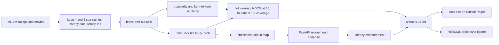

# Streaming session recommender

> Read this file from start to finish, then build it one phase at a time (section 10).
> Time box: about 4 working days. Public repo name: `Streaming_Session_Recommender` (GitHub user `ag-68`). Public site: GitHub Pages from `/docs`.
> Every number on the README or the site is read from a generated file in `artifacts/`. Never type a result by hand.

This file is the build spec. It is written so a product reader can follow the argument, and so an engineer can implement it without guessing.

---

## 1. What this work is

This is a comparison of three methods that already exist. It is not a new recommendation algorithm, and it is not a reproduction of the scores printed in the original papers.

Picture a cooking test. Three known recipes are made from the same ingredients, under the same rules, and tasted side by side. The useful result is that comparison. Calling one recipe new would be false. Saying it tastes exactly like the photo in the cookbook would also be false, because a few ingredients were changed on purpose.

The three methods are:

1. **Popularity.** Show the films that received the most positive ratings. Almost every viewer gets the same shelf.
2. **Item-to-item similarity.** If people who liked *Heat* often also liked *Collateral*, suggest *Collateral* after *Heat*. This idea comes from Sarwar, Karypis, Konstan, and Riedl (2001).
3. **SASRec.** Read the viewer's liked films in order and predict the next one. Kang and McAuley introduced this model in 2018. We implement that model. We do not invent a successor to it.

The public page and the README say this in one paragraph: known methods, one shared test, our own measured numbers. They do not say "a novel recommender." They do not say "we reproduced the SASRec paper's scores."

The paper's scores are not a target, for three practical reasons:

1. The paper counted every rating, including 1 star, as a positive event. This project keeps only 4- and 5-star ratings, because a disliked film should not count as a good next watch.
2. The paper trained by comparing the right film with one random wrong film. This project asks the model to find the right film in the whole catalog, which is also how the final test works.
3. The paper scored a guess against 100 random wrong films. This project scores it against every film the viewer has not already seen. A high score in a lineup of 100 is not the same achievement as a high score in a lineup of a few thousand.

A reader can trust the comparison inside this project. A reader cannot place our score next to the SASRec paper's table and call the difference better or worse.

### What this work adds

The added value is a finished, inspectable piece of work.

Reading the SASRec paper tells you that a sequence model can be strong. It does not show the data preparation, a fair test, a service that returns five films, and a page that explains the result to someone who does not build recommenders. This project is that demonstration.

- **A product-shaped question.** "Given the films this person recently liked, what should the home row show next?"
- **One set of rules for every method.** The same history, the same ban on films already seen, and the same scoring code. A higher score cannot come from giving the sequence model an easier exam.
- **A service, not only a score.** The API returns five films. If the viewer has no usable history, it falls back to popularity and says so. A measured response time shows whether that answer comes back quickly on this catalog.
- **A page that teaches the result.** The demo walks from an everyday case to the test and then to the numbers. Every number is loaded from a generated file.

The honest claim is: here is what these known methods do under rules that match a next-watch story, and here is the service that returns the answer.

---

## 2. Scope

**In scope:** data preparation, popularity, item-to-item similarity, SASRec training, evaluation, a FastAPI inference service, a latency measurement, tests, a static site, and a README.

**Out of scope:** online A/B tests, a feature store, GPU serving, multi-objective re-ranking, a product user interface beyond the static site, a live hosted API, notebooks, and experiment-tracking platforms. Also out of scope: GRU4Rec, BERT4Rec, and a two-stage candidate-generation system. Those are cited so a reader knows where this work sits. They are not built.

**Cut list if behind schedule, in this order:** (1) Docker, (2) GitHub Actions, (3) three-seed mean and spread (use one seed), (4) slice analysis (Test 4), (5) the viewer switcher on the site (keep a static table of the twelve examples). **Never cut:** tests, the latency measurement, the three-way comparison, or the README results.

---

## 3. What counts as a good next watch

MovieLens does not record plays. It records star ratings. A rating of 4 or 5 is treated as "this person liked this film." A rating of 1, 2, or 3 is left out of the sequence.

Example: a viewer gives *Heat* 5 stars, *Batman & Robin* 1 star, and *Collateral* 4 stars. The useful path is *Heat → Collateral*. If every rating counted as a success, predicting *Batman & Robin* would look like a win merely because the viewer bothered to rate it.

The star value is not used as a weight. After the filter, every kept film counts as one positive event. Kang and McAuley counted every rating. This project uses the stricter rule on purpose, and says so.

| Item | Value |
|---|---|
| Dataset | MovieLens 1M, from GroupLens |
| Download | `https://files.grouplens.org/datasets/movielens/ml-1m.zip` |
| Files used | `ratings.dat` (`UserID::MovieID::Rating::Timestamp`), `movies.dat` (`MovieID::Title::Genres`). The separator is the two characters `::`. |
| Raw-file check | 1,000,209 ratings and 6,040 users, asserted on the downloaded file before any filtering |
| Positive event | rating is 4 or 5 |
| Short histories | drop a viewer who has fewer than 5 positive films left, so the split below still has a training sequence |
| Counts after filtering | computed by the code and written to `artifacts/`. Do not hard-code them. |
| Citation | Harper and Konstan (2015), "The MovieLens Datasets: History and Context" |

Rules:

- Download with `scripts/download_data.py`. Do not commit the zip or the `.dat` files (`data/` is in `.gitignore`). Link to GroupLens in the README and follow the dataset's own terms.
- Order each viewer's kept films by `(timestamp, original row order)` with a stable sort. Many ratings share one timestamp.
- Remap the kept `MovieID` values to contiguous integers `1..N`. Reserve `0` for empty padding. Raw ids have gaps, and padding must never be recommended.
- Films that only appeared in 1–3 star ratings disappear from the catalog. Say that in the README.

### How each viewer's sequence is split

This is the leave-one-out protocol used by the SASRec paper: hide each viewer's last liked film, then ask the model to guess it. "Leave-one-out" means the last event is held back as the question.

For a viewer with liked films `i_1 … i_n` in time order (`n` is at least 5):

- **Training sequence:** `i_1 … i_{n-2}`. The model may learn from these.
- **Validation target:** `i_{n-1}`. The input is the training sequence. Validation is the practice exam used to decide when to stop training.
- **Test target:** `i_n`. The input is the training sequence plus the validation film. The test is the final exam. It is touched once, with the checkpoint that did best on validation.

Example with five films, A B C D E, oldest to newest:

- Learn from A B C.
- Practice question: given A B C, the hidden film is D.
- Final question: given A B C D, the hidden film is E. E is never part of the input.

### How a guess is scored

- **Full ranking.** Score every film in the catalog for each viewer. Do not score the true film against a random handful of wrong films.
- **Already-seen films are removed** from the candidate list, for every method, by the same code the API uses. Recommending *Heat* to someone who just watched *Heat* is not a success.
- **NDCG@10** (normalized discounted cumulative gain at 10) is the headline. With one correct film per viewer: if that film sits at rank `r` (counting from 1) and `r` is 10 or better, the viewer's score is `1 / log2(r + 1)`. Otherwise it is 0. Average over viewers. A hit in position 1 scores 1. A hit in position 2 scores `1 / log2(3)`, about 0.63. A hit in position 11 scores 0.
- **HR@10** (hit rate at 10) is 1 when the hidden film is anywhere in the top 10, and 0 otherwise. Average over viewers. Position 1 and position 10 both count as a hit. NDCG@10 is what tells them apart.
- **Catalog coverage@10** is the share of all films that appear in at least one viewer's top 10. A method can be accurate while always recommending the same ten blockbusters. Coverage asks how much of the shelf is used.
- The test split is scored once.

---

## 4. The three methods

All three receive the same history, may not recommend a film already in that history, and are scored by one function. Popularity counts and item-to-item similarities are estimated from training sequences only. They do not get to see the hidden validation or test films while they are being built. At test time the history may include the validation film, because that film is already "known" when the final question is asked.

### Popularity

Rank films by how many training-sequence events they have. Break ties by the remapped id, ascending, so the order is stable. This is the sanity check. A sequence model that cannot beat "show what everyone liked" has not earned its complexity.

### Item-to-item similarity

Build a table of viewers and films from the training sequences. A cell is 1 if that viewer liked that film in training, and 0 otherwise. The star rating is not reused as a weight.

Similarity between two films is the cosine of those two columns: films liked by the same viewers score high. For each film, keep the 50 most similar other films and set the rest of its similarities to 0. Fifty is a starting value. Record the value actually used.

To score a history, add the stored similarities between each film in the history and each candidate. Films already in the history are then masked out. A candidate with no stored similarity to the history gets no support from this method. If the history is empty or none of its films are known, use the popularity ranking and say so.

This method does not read order. *Heat* then *Collateral* is the same evidence as *Collateral* then *Heat*. That is the point of the comparison. SASRec's extra claim is that order helps.

### SASRec

SASRec (self-attentive sequential recommendation) treats the history like a sentence and tries to fill in the next word.

> The viewer liked *Heat*, then *The Departed*, then …
> The model completes that sentence with the most plausible next film.

Implement the Kang and McAuley backbone in PyTorch, about 100–150 lines:

- Each film is stored as a learned list of numbers, called an embedding. The same embedding is used to score candidate films, so a score is a dot product. Scale the embedding by `sqrt(d)`, add a learned position embedding so the model knows which film came first, then apply dropout.
- Stack `B` Transformer-style blocks. Each block is: causal self-attention, a residual connection and layer norm, a small feed-forward network, then another residual connection and layer norm.
- **Causal mask.** When the model is learning from position `t`, it may look at positions `1..t` only. It may not look at the film it is supposed to predict. Changing the film at position `t` must leave the outputs at earlier positions unchanged. A test locks this.
- **Left-pad** sequences to `max_len`. Padding id is `0`. Padding is an empty slot, not a film. Use the causal mask only, and multiply padded positions by zero. A row of attention that is entirely masked produces `NaN`. Do not use a key-padding mask for that reason.
- **Loss.** Full-catalog cross-entropy at every position (`ignore_index=0`). The target at each position is the next film in the input, which means the targets are the inputs shifted one step to the left. Cross-entropy means a confident wrong answer is punished more than an uncertain one. The paper instead used binary cross-entropy against one random wrong film. We use the full catalog so the training question matches the test question. Say that next to the citation.
- Each epoch, take a random window of up to `max_len + 1` films from each viewer's training sequence.

### Starting settings

Tune in at most two extra runs. Record every run, including the ones that were worse.

| Name | Start value | In plain words |
|---|---|---|
| `max_len` | 100 | how many recent films the sequence model can see |
| `hidden_dim` | 64 | length of each film's embedding |
| `num_blocks` | 2 | how many attention blocks are stacked |
| `num_heads` | 1 | parallel attention heads per block |
| `dropout` | 0.2 | fraction of values randomly dropped while training |
| optimizer | Adam, learning rate 1e-3 | how the weights are updated |
| `batch_size` | 256 | viewers per update |
| epochs | 100, stop after 10 with no validation NDCG@10 gain | when to give up on a run |
| `item_knn_neighbors` | 50 | similar films kept per film |
| seed | 42 | stretch goal: seeds 42, 43, 44, then report the mean and the spread |

### Libraries

Use these. Do not add others without asking.

`torch`, `numpy`, `pandas`, `fastapi`, `uvicorn`, `pydantic` (comes with FastAPI), `httpx` (needed by FastAPI's `TestClient`), `pytest`, `matplotlib` (README figures), `ruff` (lint and format). Python 3.10+.

The site uses the same pinned browser libraries as the reference page, loaded from a CDN: Tailwind (`https://cdn.tailwindcss.com`), Plotly 2.35.2, and KaTeX 0.16.22. There is no build step.

### Words used on the site

Each entry is the term, the open form where it has one, and one precise sentence. The site glossary uses these sentences.

| Term | Open form | Sentence |
|---|---|---|
| SASRec | Self-attentive sequential recommendation | A model that reads a viewer's liked films in order and scores the next film. |
| NDCG@10 | Normalized discounted cumulative gain at 10 | A score that is 1 when the hidden film is in position 1, smaller when it is lower in the top 10, and 0 when it is missing. |
| HR@10 | Hit rate at 10 | The share of viewers whose hidden film appears anywhere in the top 10. |
| Leave-one-out | — | Hide each viewer's last liked film, then ask the method to guess it. |
| Causal mask | — | A rule that position `t` may look only at positions up to `t`, so the model cannot see the answer it is predicting. |
| Embedding | — | A learned list of numbers that stands for one film. |
| Cross-entropy | — | A training penalty that is larger when the model is confidently wrong. |
| Cold start | — | A viewer whose history is empty, or contains only films this catalog does not know. |
| Catalog coverage | — | The share of films that appear in at least one viewer's top 10. |
| p50 / p95 / p99 | — | Response-time marks. p95 means 95% of requests finished in this time or less. |
| Full ranking | — | The hidden film is ranked against every film the viewer has not already seen, not against a random sample of wrong films. |
| API | Application programming interface | The HTTP menu other programs use to ask for five films. |

---

## 5. Related work

Say what each study contributed, and whether this project builds it.

- **Sarwar, Karypis, Konstan, and Riedl (WWW 2001).** If two films are liked by the same people, each one is evidence for the other. **Built**, as the traditional comparison. Order does not matter to this method.
- **Kang and McAuley (ICDM 2018).** SASRec. Attention can mix a viewer's recent films with the longer path that came before them. **Built**, with two documented changes: only 4- and 5-star films count, and the model must pick the next film from the whole catalog.
- **Hidasi, Karatzoglou, Baltrunas, and Tikk (2016).** GRU4Rec reads a viewing sequence one film at a time with a recurrent network, and was an important step before attention models. **Cited only.** It is not implemented.
- **Sun, Liu, Wu, Pei, Lin, Ou, and Jiang (CIKM 2019).** BERT4Rec hides a film in the middle of a sequence and looks both backward and forward to fill the blank. **Cited only.** This project predicts the next film, so it is not allowed to look forward.
- **Covington, Adams, and Sargin (RecSys 2016).** At YouTube scale, the system first pulls a short list of candidates, then ranks that short list. **Cited only.** MovieLens has a few thousand films, so every method here can score the whole catalog. A shortlist would matter if the catalog grew to millions of titles.
- **Dacrema, Cremonesi, and Jannach (RecSys 2019).** A careful re-run of neural recommenders found that a plain neighbor method often matched them. This is why item-to-item similarity is in the comparison, and why beating popularity alone is not treated as a research result.
- **Krichene and Rendle (KDD 2020).** Ranking against a random sample of wrong films does not measure the same thing as ranking the whole catalog. This is why the test uses full ranking, and why our numbers are not placed next to the SASRec paper's table.
- **Harper and Konstan (2015).** The MovieLens datasets. The data citation.

---

## 6. What this experiment cannot prove

Write these limits on the site and in the README, with the examples.

- **Ratings are not plays.** MovieLens says a person rated a film. It does not say they watched it to the end, or that they would press play today.
- **A hidden-film hit is not a happier viewer.** Finding a held-out 5-star film is encouraging. It does not show that a real home row would increase plays or keep people subscribed. That needs an online test with real viewers.
- **The split is not one shared clock time.** Each viewer's last liked film is hidden, but those "last" events happened on different dates. Suppose Ann's hidden film is from March and Ben's training films run through June. The model can learn from Ben's June activity, then be scored on Ann's March question. That is data leakage: the model learned something that would not have been available at the moment of the prediction. Ji, Sun, Zhang, and Li (TOIS 2023) explain this risk. A fix is a single global cutoff, where training uses only events before a chosen date. That fix is not part of this four-day build. The limit is stated instead.
- **A fast answer on MovieLens is not a fast answer at streaming scale.** Finishing 95% of requests in under 50 ms shows that this service meets its budget on a few thousand films, on one CPU, on localhost. It does not show that the same design can search millions of titles or serve millions of people.
- **One dataset, one protocol.** The ranking is about MovieLens 1M under the rules in section 3. It is not a universal ordering of the three methods.
- **Item-to-item similarity may win.** That result is published. It is not a reason to change the test, drop the neighbor method, or keep tuning until the sequence model is ahead. At most two extra training runs are allowed, and only to fix a real training problem, not to chase a win.

---

## 7. Pipeline



---

## 8. Repo layout

```
Streaming_Session_Recommender/
├─ streaming_recommender.md    (this file)
├─ README.md
├─ requirements.txt
├─ Makefile                    (data, baselines, train, evaluate, serve, bench, test, site-data, figures, all)
├─ .gitignore                  (data/, __pycache__/, .venv/, checkpoints if large)
├─ src/sessrec/
│  ├─ config.py                (the settings in section 4)
│  ├─ data.py                  (load, filter, order, remap, split, training windows)
│  ├─ metrics.py               (ndcg_at_k, hit_rate_at_k, coverage_at_k)
│  ├─ baselines.py             (Popularity, ItemItemSimilarity)
│  ├─ model.py                 (SASRec)
│  ├─ train.py                 (loop, early stopping, checkpoint)
│  ├─ evaluate.py              (one full-ranking function for any scorer)
│  ├─ export_site_data.py      (writes docs/data/*.json from artifacts/)
│  └─ serve/
│     ├─ schemas.py
│     ├─ inference.py          (load once, score, mask, top-k)
│     └─ app.py
├─ scripts/
│  ├─ download_data.py
│  └─ benchmark_latency.py     (real HTTP calls against a running server)
├─ tests/
│  ├─ test_metrics.py  test_data.py  test_model.py
│  ├─ test_baseline_comparison.py  test_api.py  test_latency.py
├─ artifacts/                  (commit metrics, curves, latency, slices; commit the checkpoint if under about 25 MB)
└─ docs/                       (index.html, style.css, app.js, data/)
```

Optional: `Dockerfile`, `.github/workflows/ci.yml`.

---

## 9. Pass rule

SASRec's test NDCG@10 must be higher than popularity's. The item-to-item result is written beside them whether it is higher or lower.

If SASRec does not beat popularity, do not change the test and do not edit the numbers. Debug in the order in section 16. At most two extra training runs. Then publish the honest result and say the pass rule was not met.

---

## 10. Build order

Each phase ends with an acceptance command. Do not start the next phase until that command is green. Commit after every green phase, with a message `phaseN: what changed`.

### Phase 0 — Scaffold (about 0.5 h)

Create the layout, the virtual environment, `requirements.txt`, the Makefile, `.gitignore`, and a placeholder test.

**Accept:** `make test` runs and passes.

### Phase 1 — Data, metrics, and the two simple methods (about 6 h)

1. `scripts/download_data.py` downloads, unzips into `data/raw/`, and asserts 1,000,209 ratings and 6,040 users on the raw file.
2. `data.py` parses `::`, keeps ratings of 4 and 5, drops viewers with fewer than 5 kept films, stable-sorts by time, remaps ids to `1..N`, splits as in section 3, and saves `artifacts/data_stats.json` (raw counts, counts after the filter, viewers dropped, `N`) plus `artifacts/item_map.json` (raw id, index, title).
3. `metrics.py` and `tests/test_metrics.py`, tests first. A hit at rank 1 has NDCG 1. A hit at rank 2 has NDCG `1/log2(3)`. A true film at rank 11 scores 0. Coverage is checked on a tiny hand-made example.
4. `baselines.py` and `evaluate.py`. One function takes any `score(history) → vector of N scores` and returns the metrics. `tests/test_data.py` checks: the test film is never in its own input; the validation film is in the test input; each viewer's order is non-decreasing in time; ids are contiguous from 1; a 3-star rating never appears; popularity and similarities are fit on training sequences only.
5. Run both simple methods to `artifacts/baselines.json`.

**Accept:** `make test` is green, and `make baselines` writes NDCG@10 and HR@10 for popularity and item-to-item similarity.

### Phase 2 — SASRec (about 6 h)

1. `model.py` as in section 4. `tests/test_model.py` first:
   - output shape `(batch, max_len, N+1)` or an equivalent that still scores every catalog id;
   - no peeking: change the film at position `t` and confirm outputs before `t` stay the same;
   - no `NaN` when almost the whole sequence is left-padding;
   - learnability: on a tiny synthetic catalog where film `i` is always followed by `i+1`, a few epochs reach near-perfect next-film accuracy.
2. `train.py`: windows, validation NDCG@10 each epoch, early stopping, best checkpoint at `artifacts/sasrec.pt`, per-epoch log at `artifacts/curves.json` (training loss, validation NDCG@10).
3. `evaluate.py` on the test split writes `artifacts/metrics.json` for all three methods.
4. `tests/test_baseline_comparison.py` loads `artifacts/metrics.json`. It asserts that all three NDCG@10 values are present and finite, and that SASRec's NDCG@10 is greater than popularity's. It does not assert a win over item-to-item similarity.

**Accept:** `make train && make evaluate && make test` is green. If the popularity comparison fails, walk section 16 before changing a setting, and report what was tried.

### Phase 3 — Service, latency, slices (about 6 h)

1. `serve/inference.py` loads the checkpoint once at startup (FastAPI lifespan), calls `model.eval()` and `torch.inference_mode()`, keeps only the last `max_len` films, scores with the last position's hidden state times the film-embedding matrix, sets the logit for id `0` and for seen films to `-inf`, then takes `topk(k)`. Run a few warm-up calls at startup. Try `torch.set_num_threads(1)` and keep the setting with the lower p95.
2. `serve/app.py` follows section 11. An empty history, or a history of only unknown ids, returns the popularity list with `"strategy": "popularity_fallback"`.
3. `tests/test_api.py` and `tests/test_latency.py`. The latency test is marked `latency`: 500 in-process requests through `TestClient` after 50 warm-ups, and it asserts p95 under 50 ms.
4. `scripts/benchmark_latency.py` starts uvicorn with one worker, sends 1,000 real HTTP requests with `httpx` on localhost after 50 warm-ups, for history lengths 5, 20, 50, and 100, and writes p50, p95, p99, and the hardware (CPU model, core count, OS, Python version, torch version) to `artifacts/latency.json`. The gate is p95 under 50 ms for the full HTTP round trip, CPU only, on this machine. The site must say this is a budget for this catalog, not a large-catalog proof.
5. Slices, skip if behind: NDCG@10 by history-length bucket and by whether the hidden film is in the head, middle, or tail of the training popularity counts (terciles), for all three methods, to `artifacts/slices.json`.
6. Optional Dockerfile (slim Python image, uvicorn as the entry point).

**Accept:** `make test` is green, and `make bench` writes `artifacts/latency.json` with p95 under 50 ms.

### Phase 4 — Site, README, publish (about 6 h)

1. `export_site_data.py` writes `docs/data/`: `metrics.json`, `curves.json`, `latency.json`, `slices.json` if it exists, `demo_users.json` (section 14), and `glossary.json`.
2. Build `docs/` as in section 14. `make figures` writes the README PNGs with matplotlib.
3. README as in section 15.
4. GitHub → Settings → Pages → deploy from branch `main`, folder `/docs`. Open the live URL and click every tab at a desktop width and at a phone width.
5. Fresh clone, new environment, `make all`. The numbers should come back. Small differences from the machine or a retrained seed are acceptable if the README says so. Prefer shipping the checkpoint so `make serve` does not require a retraining.

**Accept:** the public URL loads, the README renders on GitHub, and every number on the site equals the value in `artifacts/*.json`.

---

## 11. API contract

`GET /health` → `{"status": "ok", "model_version": "<string>"}`

`POST /recommend`

```json
{ "history": [101, 202, 303], "k": 5 }
```

- `history`: raw MovieLens movie ids, oldest to newest, length 0–500. Only the last `max_len` are used. The example ids above are placeholders; use real ids from `movies.dat`.
- `k`: integer 1–50, default 5.

Response `200`:

```json
{
  "recommendations": [
    { "rank": 1, "movie_id": 0, "title": "string", "score": 0.0 }
  ],
  "strategy": "sasrec",
  "model_version": "string",
  "ignored_ids": [],
  "latency_ms": 0.0
}
```

- Exactly `k` unique films, none of them in `history`.
- Unknown ids are skipped and listed in `ignored_ids`.
- `strategy` is `"sasrec"` or `"popularity_fallback"`.
- `latency_ms` is the time from the validated request to the finished top-k, model path only. The benchmark script measures the full HTTP round trip separately.
- Invalid input (bad `k`, a non-integer id, a history longer than 500) returns `422`, FastAPI's default.
- Interactive docs are at `/docs`. Mention them in the README.

The item-to-item list is not a third serving strategy. It is an offline comparison. The try-it tab shows it from precomputed JSON.

---

## 12. Tests

| File | What a passing test shows |
|---|---|
| `test_metrics.py` | NDCG, hit rate, and coverage match hand-worked cases. |
| `test_data.py` | Time order, no test film in its own input, contiguous ids, the raw file size, the 4-and-5-star rule, and simple methods fit on training sequences only. |
| `test_model.py` | Output shape, no peeking, no `NaN` under padding, and a synthetic "i is always followed by i+1" rule can be learned. |
| `test_baseline_comparison.py` | All three test NDCG@10 values exist, and SASRec is above popularity. It does not require SASRec to beat item-to-item similarity. |
| `test_api.py` | `/health`; top-k length and uniqueness; seen films excluded; unknown ids reported; empty history uses the popularity fallback; `k` is validated. |
| `test_latency.py` | In-process p95 under 50 ms. Marker `latency`, so a noisy CI run can skip it with `pytest -m "not latency"`. |

---

## 13. Definition of done

- [ ] `make all` runs from a fresh clone: download, simple methods, train, evaluate, bench, site data, figures, tests.
- [ ] `artifacts/metrics.json` has NDCG@10, HR@10, and coverage@10 for popularity, item-to-item similarity, and SASRec on the test split.
- [ ] SASRec's test NDCG@10 is higher than popularity's, or the README states that the pass rule was not met and the numbers are the honest ones.
- [ ] The item-to-item comparison is published even if it wins.
- [ ] `POST /recommend` returns five films, and `artifacts/latency.json` shows p95 under 50 ms for the HTTP round trip on localhost, CPU, with the hardware named.
- [ ] The tests in section 12 pass.
- [ ] The public site is live and follows section 14.
- [ ] The README follows section 15. No number in it was typed by hand.
- [ ] No raw dataset files are committed. GroupLens, SASRec, and the item-to-item paper are cited.
- [ ] The page states the limits in section 6.

---

## 14. The one-page demo

Match the reference page side by side: [closed-loop message orchestrator](https://ag-68.github.io/Causal_Decisioning_Multi_Objective_Orchestrator/). Source of the look: dark background `#10140f`, cards `#1a2118`, borders `#2c3826`, the small uppercase kicker, the large title, the "Get git repo" pill, the opening motive block with scene cards, then a tab bar. Use one accent for marked phrases, in the same spirit as that page. Light and dark switching is not required. The reference is dark only.

Files: `docs/index.html`, `docs/style.css`, `docs/app.js`, `docs/data/*.json`. Tabs are buttons. The URL hash selects a tab so a tab can be linked. Charts have an accessible name. The page is readable on a phone. While JSON is loading, show the words "Loading…" so the layout does not jump. No framework build step. Plotly draws the charts. KaTeX draws the one NDCG formula.

**Kicker:** Rating-aware Self-Attention. **Title:** Next-Movie Recommender. Formal: Self-Attentive Sequential Recommendation (SASRec).

**Tabs:** Overview · Problem formulation · Benchmarks & tests · Results · Try it (precomputed)

### Above the tabs

One short motive, then three scene cards.

Opening: a viewer liked *Heat* and then *Collateral*. The home row has to suggest the next film. A popularity row offers the same widely liked films to everyone and ignores that path.

Scene cards:

1. **The path.** *Heat*, then *Collateral*. The next suggestion should continue that path, not start a new one at random.
2. **The easy rule.** Popularity fills the row with films most people rated highly. It is a fair sanity check, and it is the wrong row for a viewer whose recent likes point somewhere else.
3. **What we compare.** Item-to-item similarity asks which films share an audience. SASRec also reads the order. Both are known methods. The page reports which one placed the hidden film higher under the rules in section 3.

A sentence under the cards states the claim from section 1, including the three reasons our numbers are not the paper's numbers.

### Overview — What problem are we solving?

- The motive above can be repeated in shorter form if the tab is opened directly.
- "Our approach," in the reference page's marked-phrase style: take the films this viewer rated 4 or 5, in order, and compare three known ways to guess the next one. Serve the sequence model's answer from a small API, and fall back to popularity when the history is empty.
- Three headline numbers from `metrics.json` and `latency.json`: SASRec NDCG@10, the better of the two simple methods' NDCG@10, and p95 latency. Label them in the sentences from section 4. If item-to-item similarity is ahead, the headline says so.
- Links: the git repo, and the API section of the README.

### Problem formulation — What does the model get to see?

- A notation table. Every symbol has the plain words in parentheses: viewers, films, the ordered sequence, history length `L`, and the size of the list `k`.
- A split diagram for one viewer, using the A B C D E example from section 3. Name the three roles in everyday words: the training films are what the method learns from, the validation film is the practice question used to choose when to stop, and the test film is the final exam. The final exam is scored once.
- The 4-and-5-star rule, the stable time sort, the id remap, and the sentence that a rating is not a play.
- The NDCG@10 formula in KaTeX, plus the worked case: rank 1 scores 1, rank 2 scores `1/log2(3)`, rank 11 scores 0.
- One sentence on full ranking: the hidden film competes with the whole remaining catalog.

### Benchmarks & tests — What would count as convincing?

Each test uses four headings: Purpose of test, Setup, Benchmarks, Key takeaway. The methods box sits on this tab: the settings actually used, the definitions of the two simple methods, and the library names.

- **Test 1 — Next-film accuracy.** Purpose: did the sequence model place the hidden film higher than the simple rules? Setup: the test split, full ranking, seen films removed. Benchmarks: popularity, item-to-item similarity, SASRec. The pass line is SASRec above popularity. The item-to-item result is shown either way.
- **Test 2 — Training behaviour.** Purpose: did validation NDCG@10 rise, and when did training stop? Setup: one curve from `curves.json`. Benchmarks: the early-stopping rule (10 epochs with no gain). Key takeaway states the epoch where the best checkpoint was kept.
- **Test 3 — History length.** Purpose: how much of the recent path does each method need? Setup: at evaluation time only, give each method the last 5, 10, 20, 50, or 100 films. Do not retrain. Benchmarks: NDCG@10 for all three.
- **Test 4 — Who is this hard for?** Skip the panel if `slices.json` is absent, and say it was not run. Otherwise: NDCG@10 by short versus long histories, and by whether the hidden film is widely liked, middling, or rarely liked.
- **Test 5 — Response time.** Purpose: does the API answer quickly enough on this catalog? Setup: the warm-up count, the request count, the history lengths, and the named hardware from `latency.json`. Draw the 50 ms line. The takeaway says 95% of requests finished in the p95 time or less, and that this is not a million-title result.

### Results — What happened?

Tables and charts are drawn only from the JSON files. Under each chart, one sentence says what the chart can support, and points to section 6 for what it cannot. The key-takeaways panel is filled from the JSON values. If a human still needs to write the judgment, leave the visible marker `TODO(human): write takeaways from results` rather than inventing a story.

### Try it — What do the lists look like?

Say, in the first sentence, that the rows are precomputed from the trained model. GitHub Pages can show saved results. It cannot run the Python service.

`demo_users.json` holds 12 test viewers chosen with a fixed seed. For each: the last 8 liked titles, the top 5 from SASRec, the top 5 from item-to-item similarity, the top 5 from popularity, the hidden next film, and whether that film landed in each method's top 10. A menu switches the viewer. Under the lists, show a `curl` example for the real API, with real movie ids, and say the API itself is not running on this page.

### Glossary

A collapsible panel using the sentences in section 4.

---

## 15. README

1. Title, a one-line description, and badges (CI if it exists, Python version, license).
2. The results table from `artifacts/metrics.json`: popularity, item-to-item similarity, SASRec, with NDCG@10, HR@10, and coverage@10. Add p50 and p95 with the hardware. If SASRec lost to popularity, say the pass rule was not met.
3. The live site link and a screenshot.
4. What this is, in 3–5 sentences, using section 1. Known methods, shared rules, our numbers. No claim about any company's system.
5. Quickstart:

   ```
   python -m venv .venv && source .venv/bin/activate
   pip install -r requirements.txt
   make data train evaluate
   make serve        # then open http://127.0.0.1:8000/docs
   curl -X POST http://127.0.0.1:8000/recommend -H "Content-Type: application/json" -d '{"history":[...],"k":5}'
   ```

   If the checkpoint is in the repo, `make serve` works without training. On Windows, show the `venv` activate command as well.

6. The method, in short, with the diagram from section 7 and the settings that were actually used.
7. The evaluation rules: 4- and 5-star films, leave-one-out, full ranking, seen films removed, test touched once.
8. The API contract from section 11, with one real request and response.
9. Latency: what was timed, warm-ups, request count, hardware, and one sentence of result. Include the catalog-size limit.
10. The test table from section 12, and how to run it (`make test`, `pytest -m "not latency"`).
11. Figures: metric bars, the training curve, latency by history length.
12. The limits from section 6, plus what was not built: content features such as genre, a global time cutoff, online evaluation, and a two-stage retriever.
13. Where a later project could go, as three possibilities, not promises: business-rule re-ranking, genre or metadata features, an online evaluation.
14. Related project: [Causal_Decisioning_Multi_Objective_Orchestrator](https://github.com/ag-68/Causal_Decisioning_Multi_Objective_Orchestrator).
15. Citations from section 5, plus the GroupLens download link.
16. License. Leave `TODO(human): choose` until a human picks one (MIT is a reasonable choice for the code). The dataset stays under GroupLens terms.

Do not put employer names, dates, degrees, or metrics from other work anywhere in the repo. This work stands on its own.

---

## 16. Pitfalls

Check these before changing a setting.

- Ids off by one. Padding is `0`. Real films are `1..N`. Padding is never recommended.
- Targets are the inputs shifted one step left. The loss ignores padding.
- A fully masked attention row produces `NaN`. Use the causal mask only, and zero out padded positions.
- The test input includes the validation film and never includes the test film.
- Seen-film removal is the same function in evaluation, in both simple methods, and in the API.
- Popularity counts and item-to-item similarities are fit on training sequences only.
- Timestamps often tie. The sort is stable, and the README says so.
- The service calls `model.eval()` and `torch.inference_mode()`, and loads the checkpoint once.
- Latency measured before the warm-up calls is discarded.
- A looser seen-film rule for one method inflates its lead. One evaluation function serves all three.
- Do not edit a test threshold or a metric to make a result pass.
- Do not put this project's NDCG next to the SASRec paper's table.

---

## 17. Build rules

- Follow the phases in order. Stop and report after each acceptance command.
- Typed functions, short docstrings, no dead code, no notebooks.
- Do not add dependencies beyond section 4 without asking.
- Do not invent results, hardware, dates, or biographical facts. Missing human choices stay `TODO(human)`.
- Write a test before the code it locks, where section 10 says so.
- Small commits, one per green phase: `phaseN: what changed`.
- If a library call is uncertain, use the behaviour in the official PyTorch, FastAPI, or pytest docs, or ask.

---

## 18. Appendix: phase prompts

These prompts are for the build. They are not copy for the README or the site.

**Phase 0 and 1.** Read this file fully. Execute Phase 0 and Phase 1 only. After the acceptance command passes, show `artifacts/baselines.json` and `artifacts/data_stats.json`, then stop.

**Phase 2.** Phase 1 is done. Execute Phase 2. Write the model tests first. If SASRec does not beat popularity, walk section 16 before changing a setting, and report what was tried. Do not require a win over item-to-item similarity.

**Phase 3.** Execute Phase 3. Report p50, p95, and p99 from `artifacts/latency.json` and the hardware. If p95 is above 50 ms, profile thread count, history length, and the top-k step, and report that before changing the design.

**Phase 4.** Execute Phase 4. Match the reference site named in section 14. Every number comes from `docs/data/*.json`. Leave `TODO(human)` for the takeaways text and the license.
